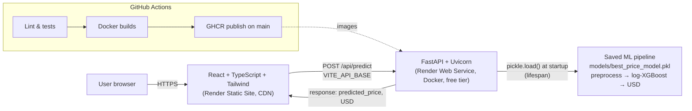

# Airbnb Pricing Intelligence — Decision Support System


An **AI-powered Decision Support System (DSS)** that estimates the nightly price of an
Airbnb listing in New York City from its property characteristics — helping **Airbnb
hosts and property managers make more informed pricing decisions** using
machine-learning predictions.

Predictions are **decision support, not appraisal**: they are estimates based on a
historical dataset and may not reflect current market conditions.

| Live Application          |                                                   |
| ------------------------- | ------------------------------------------------- |
| **Frontend (React)**      | https://airbnb-pricing-frontend.onrender.com      |
| **Backend API (FastAPI)** | https://airbnb-pricing-api-dz8f.onrender.com      |
| **Interactive API docs**  | https://airbnb-pricing-api-dz8f.onrender.com/docs |

> **Note:** the backend runs on Render's free tier and sleeps after ~15 minutes of
> inactivity. The **first request after an idle period can take ~50 seconds** while the
> service wakes up — subsequent requests are fast.

---

## 1. Project Overview

Airbnb hosts have no straightforward answer to "what should I charge per night?". This
project turns a trained machine-learning model into a practical decision-support
application: a host enters their listing's characteristics (location, room type,
availability, review history), and the system returns an estimated nightly price in USD
with the methodology documented.

The application is a full production-style stack — **React frontend, FastAPI backend,
Docker containers, GitHub Actions CI/CD, Render deployment** — wrapping a model that was
trained, compared, tuned, and evaluated offline. The saved model artifact is used
as-is at inference time; nothing is retrained in the running system.

## 2. Key Features

- **Nightly price prediction** from 9 listing characteristics via a saved tuned
  Log-XGBoost regression pipeline
- **User-friendly property form** — responsive on desktop, tablet, and mobile, with
  client-side validation (ranges, required fields)
- **FastAPI prediction endpoint** with Pydantic request validation and typed responses
- **Health endpoint** reporting model-loading status and library versions
- **Graceful error handling** — clear 422 messages for invalid input, no stack traces
  exposed; friendly "service waking up" messaging when the free-tier backend is cold
- **Dockerized local stack** (`docker compose up --build`) with health-checked
  containers and Nginx API proxying
- **Automated CI/CD** — lint, tests, type-check, Docker builds, and GHCR image
  publishing on every PR/push

## 3. Machine Learning Methodology

**Dataset:** [NYC Airbnb Open Data (2019)](https://www.kaggle.com/datasets/dgomonov/new-york-city-airbnb-open-data)
— 48,895 listings across Manhattan, Brooklyn, Queens, Bronx, and Staten Island.

**Preprocessing (captured inside the saved pipeline):**

- Removal of zero-price listings; missing `reviews_per_month` imputed with 0
- Categorical features (`neighbourhood_group`, `room_type`) one-hot encoded with
  `handle_unknown='ignore'` (unknown categories at inference don't crash the API)
- Numerical features median-imputed
- All transformations fitted **on training data only** (no leakage)

**Feature engineering & experiments** (full detail in the notebook):

- Three-way 70/15/15 train/validation/test split
- Comparison of Linear Regression, Decision Tree, Random Forest, XGBoost, and a
  median-price baseline, all evaluated on the same validation set
- **Log-target experiment:** training on `log1p(price)` with `expm1` inversion via
  `TransformedTargetRegressor` — the log transform stops luxury listings (up to
  $10,000/night) from dominating the loss and was the single largest MAE improvement
- **Hyperparameter tuning:** RandomizedSearchCV (40 candidates × 5-fold CV, MAE-scored)
  over XGBoost depth/learning-rate/subsampling parameters

**Final model:** the **tuned Log-XGBoost** pipeline — preprocessing and the inverse log
transform are packaged _inside_ one persisted sklearn `Pipeline`
(`models/best_price_model.pkl`), so `.predict()` returns **real USD prices directly**
with no manual post-processing.

**Inference features (exact schema):**

| Feature                          | Type      | Values / Range                                    |
| -------------------------------- | --------- | ------------------------------------------------- |
| `neighbourhood_group`            | string    | Bronx, Brooklyn, Manhattan, Queens, Staten Island |
| `room_type`                      | string    | Entire home/apt, Private room, Shared room        |
| `latitude`                       | float     | NYC area (~40.4–41)                               |
| `longitude`                      | float     | NYC area (~−74.3–−73.6)                           |
| `minimum_nights`                 | int ≥ 1   |                                                   |
| `number_of_reviews`              | int ≥ 0   |                                                   |
| `reviews_per_month`              | float ≥ 0 |                                                   |
| `calculated_host_listings_count` | int ≥ 0   |                                                   |
| `availability_365`               | int 0–365 |                                                   |

## 4. Model Performance

All metrics below are **hold-out test-set results** (models refit on train+validation,
evaluated once on the unseen test set), reproduced from
`Airbnb_Price_Prediction_updated.ipynb` — not recalculated for this README.

| Rank | Model                                      | Test MAE   | Test RMSE   | Test R²   |
| ---- | ------------------------------------------ | ---------- | ----------- | --------- |
| 1    | **XGBoost (log target, tuned) — deployed** | **$58.19** | $270.53     | 0.147     |
| 2    | XGBoost (log target)                       | $59.11     | **$266.39** | **0.173** |
| 3    | Random Forest                              | $70.09     | $270.78     | 0.145     |
| 4    | XGBoost                                    | $70.89     | $274.94     | 0.119     |
| 5    | Decision Tree                              | $73.64     | $302.67     | −0.068    |
| 6    | Linear Regression                          | $75.73     | $282.07     | 0.073     |
| —    | Median baseline                            | $83.49     | $229.80     | −0.04     |

**Interpretation:** the deployed model's average prediction is about **$58 off** the
actual nightly price — a **~30% MAE improvement** over the median-price baseline.
RMSE is much higher than MAE because a small number of extreme luxury listings
(> $1,000/night) produce very large squared errors. The log-target variant wins on
typical listings at the cost of some large-error accuracy — the right trade-off for
host-facing suggestions. Full segment-level error analysis and the validation-stage
tables are in the notebook and `PROJECT_CONTEXT.md`.

## 5. System Architecture



- **Local development** uses the same components containerized with Docker Compose;
  Nginx (frontend container) proxies `/api/*` to the backend container.
- **Production** serves the frontend as a Render Static Site (always on) and the
  backend as a Render Docker Web Service (free tier, sleeps when idle).
- Frontend and backend communicate over HTTPS; CORS on the backend is restricted to
  the deployed frontend origin via the `ALLOWED_ORIGINS` environment variable.

## 6. Technology Stack

| Category         | Technologies                                                                                                                                               |
| ---------------- | ---------------------------------------------------------------------------------------------------------------------------------------------------------- |
| Machine Learning | Python 3.11, scikit-learn 1.7.2 (Pipeline, ColumnTransformer, OneHotEncoder, TransformedTargetRegressor), XGBoost 3.1.2, pandas, NumPy, RandomizedSearchCV |
| Backend          | FastAPI, Pydantic v2, Uvicorn, pytest + httpx                                                                                                              |
| Frontend         | React 19, TypeScript, Vite, Tailwind CSS 4, oxlint                                                                                                         |
| Containerization | Docker, Docker Compose, Nginx 1.27                                                                                                                         |
| CI/CD            | GitHub Actions (ruff, pytest, oxlint, tsc, docker build), GitHub Container Registry                                                                        |
| Deployment       | Render — Docker Web Service (free) + Static Site (free)                                                                                                    |

## 7. Project Structure

```text
Airbnb_Predictor/
├── Airbnb_Price_Prediction.ipynb        # original research notebook (preserved)
├── Airbnb_Price_Prediction_updated.ipynb# full ML workflow: pipeline, tuning, evaluation
├── PROJECT_CONTEXT.md                   # consolidated decisions & verified metrics
├── render.yaml                          # Render Blueprint (free-tier services)
├── compose.yaml                         # local Docker orchestration
├── models/
│   └── best_price_model.pkl             # saved pipeline: preprocessing + tuned Log-XGBoost
├── backend/
│   ├── app/
│   │   ├── main.py                      # FastAPI app, routes, CORS, lifespan
│   │   ├── inference.py                 # model loading + prediction (no retraining)
│   │   ├── schemas.py                   # Pydantic request/response models
│   │   └── logging_setup.py             # structured logging
│   ├── tests/                           # 21 pytest tests (incl. real-model integration)
│   ├── requirements.txt                 # pinned deps (sklearn/xgboost versions matter)
│   └── Dockerfile                       # repo-root build context, PORT-aware CMD
├── frontend/
│   ├── src/
│   │   ├── components/                  # PropertyForm, PredictionResult, ModelInfo
│   │   ├── services/                    # typed API client (api.ts, types.ts)
│   │   └── App.tsx
│   ├── nginx.conf                       # local: proxies /api/* to the backend container
│   └── Dockerfile                       # multi-stage Node build → Nginx
└── .github/workflows/ci-cd.yml          # CI/CD pipeline
```

## 8. Local Installation

### Option A — Docker Compose (recommended)

```bash
git clone https://github.com/Messiri4/Airbnb_Predictor.git
cd Airbnb_Predictor
docker compose up --build
```

- Frontend: http://localhost:8080
- Backend API: http://localhost:8000 (docs at `/docs`)

No environment variables are required locally — sensible defaults are built in.

### Option B — run the pieces separately

**Backend** (Python 3.11):

```bash
cd backend
python -m venv .venv && source .venv/bin/activate
pip install -r requirements.txt
uvicorn app.main:app --host 0.0.0.0 --port 8000   # run from repo root so MODEL_PATH resolves
pytest                                            # 21 tests, incl. real-model integration
```

**Frontend** (Node 22):

```bash
cd frontend
npm ci
npm run dev      # http://localhost:5173
npm run build    # production build (runs tsc type-check first)
npm run lint
```

**Environment variables:**

| Variable          | Where                 | Purpose                                                        | Default                                       |
| ----------------- | --------------------- | -------------------------------------------------------------- | --------------------------------------------- |
| `MODEL_PATH`      | backend               | Path to the saved pipeline artifact                            | `<repo>/models/best_price_model.pkl`          |
| `ALLOWED_ORIGINS` | backend               | Comma-separated CORS origins for the frontend                  | `http://localhost:5173,http://localhost:8080` |
| `PORT`            | backend               | Port to bind (Render injects this)                             | `8000`                                        |
| `VITE_API_BASE`   | frontend (build-time) | Backend origin for API calls; `/api` is appended automatically | _(unset → `/api`, via Nginx proxy)_           |

## 9. API Documentation

Interactive OpenAPI docs: **https://airbnb-pricing-api-dz8f.onrender.com/docs**

| Endpoint       | Method | Description                                                                       |
| -------------- | ------ | --------------------------------------------------------------------------------- |
| `/health`      | GET    | Service status, `model_loaded` flag, model name/version, sklearn/xgboost versions |
| `/api/predict` | POST   | Listing features (JSON) → estimated nightly price in USD                          |

**Request** (`POST /api/predict`):

```json
{
  "neighbourhood_group": "Manhattan",
  "room_type": "Entire home/apt",
  "latitude": 40.7549,
  "longitude": -73.984,
  "minimum_nights": 3,
  "number_of_reviews": 45,
  "reviews_per_month": 1.2,
  "calculated_host_listings_count": 2,
  "availability_365": 200
}
```

**Response (200):**

```json
{
  "predicted_price": 259.07,
  "currency": "USD",
  "model_name": "Tuned Log-XGBoost",
  "model_version": "v1"
}
```

**Errors:** invalid category values, missing fields, or out-of-range numbers return
HTTP 422 with a descriptive message. If the model failed to load at startup,
`/api/predict` returns HTTP 503 and `/health` reports `status: degraded`.
During a free-tier cold start, requests may briefly return 502/503 while the service
wakes up.

## 10. Deployment

Production runs on [Render](https://render.com)'s **free tier**, provisioned by the
Blueprint in `render.yaml`:

| Service                   | Type                                            | Configuration                                                                                      |
| ------------------------- | ----------------------------------------------- | -------------------------------------------------------------------------------------------------- |
| `airbnb-pricing-api`      | Web Service — **Docker** runtime, free instance | Repo-root Docker context, `backend/Dockerfile`, health check `/health`, model baked into the image |
| `airbnb-pricing-frontend` | Static Site — free, always on                   | `frontend/` root, `npm ci && npm run build`, publish `frontend/dist`, SPA rewrite to `index.html`  |

**How frontend and backend communicate:** the React app reads its backend origin from
the build-time `VITE_API_BASE` variable (the client appends `/api` automatically), and
sends predictions over HTTPS. The backend's `ALLOWED_ORIGINS` must contain the
frontend's origin — CORS is explicit, no wildcards.

**CI/CD:** every push/PR runs the GitHub Actions pipeline (backend lint + tests against
the real model artifact, frontend lint/type-check/build, Docker image builds); pushes
to `main` additionally publish SHA-tagged images to GHCR. Render redeploys the backend
on new `main` commits; rollback = redeploy a previous SHA-tagged image from GHCR.

**Reproducing inference locally without any server:**

```python
import pickle
import pandas as pd

with open("models/best_price_model.pkl", "rb") as f:
    pipeline = pickle.load(f)

listing = pd.DataFrame([{
    "neighbourhood_group": "Brooklyn", "room_type": "Private room",
    "latitude": 40.68, "longitude": -73.95,
    "minimum_nights": 2, "number_of_reviews": 10,
    "reviews_per_month": 0.5, "calculated_host_listings_count": 1,
    "availability_365": 120,
}])
print(pipeline.predict(listing)[0])   # USD — inverse log transform is built in
```

Requires scikit-learn 1.7.2 / xgboost 3.1.2 (see `backend/requirements.txt`) — the
pickle must be loaded with compatible library versions.

## 11. Limitations and Future Improvements

**Current limitations:**

- The model was trained on **2019 NYC Airbnb data** and does not reflect current
  market conditions, pricing, or post-2019 regulation changes.
- The model explains only part of price variation (test R² ≈ 0.15); predictions are
  estimates, and accuracy degrades for luxury listings above ~$1,000/night.
- Free-tier hosting means the backend sleeps when idle (~50 s wake-up on first use).

**Future work** _(not implemented — listed for transparency)_:

- Retrain on a recent dataset to capture current market conditions
- Add pricing-relevant features: distance to Manhattan/subway, neighbourhood-level
  price aggregates, listing-description text signals
- Model monitoring: drift detection and periodic retraining pipelines
- Prediction explanations (e.g. SHAP values) surfaced in the UI
- Prediction intervals / price ranges instead of point estimates
- A persistent database of user predictions for feedback-driven improvement

## 12. Author

**Messiri4** — [github.com/Messiri4](https://github.com/Messiri4)

## 13. License

MIT License

## 14. ML Research & Documentation

- `Airbnb_Price_Prediction_updated.ipynb` — full ML workflow: cleaning, EDA,
  preprocessing pipeline, model comparison, log-target experiment, tuning, segment
  error analysis, persistence
- `PROJECT_CONTEXT.md` — consolidated project decisions, verified metrics, and
  architecture history
- The original `Airbnb_Price_Prediction.ipynb` and historical scripts are preserved
  untouched

## Screenshots

_Suggested additions (not included to avoid fake images):_

1. The prediction form with a completed listing (desktop + mobile widths)
2. A prediction result card showing the estimated price
3. The FastAPI `/docs` Swagger page
4. GitHub Actions pipeline passing
